# Lab6Web - Praktikum JavaScript DOM

Nama  : Chelsea Meynita Vadlistya
NIM   : (isi NIM)
Kelas : (isi kelas)

## Tujuan Praktikum

1. Memahami cara JavaScript mengakses dan mengubah elemen HTML melalui DOM.
2. Menggunakan event seperti `click`, `input`, `submit`, dan `change` untuk membuat halaman web interaktif.
3. Mengubah tampilan elemen menggunakan JavaScript dan class CSS.
4. Membuat validasi form di sisi klien beserta pesan kesalahan dan pesan berhasil.
5. Membuat aplikasi sederhana (To-do List dan form pendaftaran workshop) dengan memanipulasi elemen DOM secara dinamis.
6. Memahami pentingnya atribut `defer` agar script berjalan setelah elemen HTML tersedia.

## Struktur File

```
Lab6Web/
├── index.html        # struktur halaman web
├── style.css         # pengaturan tampilan halaman
├── script.js         # kode JavaScript (DOM, event, validasi)
├── README.md         # dokumentasi praktikum
└── screenshots/      # screenshot hasil praktikum
```

## Cara Menjalankan

1. Buka folder `Lab6Web` menggunakan Visual Studio Code.
2. Pasang ekstensi **Live Server** jika belum ada.
3. Klik kanan pada `index.html`, lalu pilih **Open with Live Server**.
4. Halaman terbuka otomatis di browser (biasanya `http://127.0.0.1:5500`).
5. Uji tiap latihan: tombol, penghitung karakter, validasi form, daftar tugas, dan form pendaftaran workshop.

Alternatif: buka file `index.html` langsung di browser.

## Langkah Kerja

1. Membuka Visual Studio Code, kemudian menyiapkan folder praktikum untuk menyimpan file yang digunakan.
2. Membuat file `index.html` sebagai struktur halaman web, file `style.css` untuk mengatur tampilan halaman, dan file `script.js` untuk menuliskan kode JavaScript.
3. Membuat latihan pertama dengan menampilkan teks pada halaman web dan mengubah teks tersebut menggunakan JavaScript DOM.
4. Membuat latihan kedua dengan menambahkan tombol yang menggunakan event `click` untuk menampilkan waktu ketika tombol ditekan.
5. Membuat latihan ketiga dengan menambahkan tombol untuk mengubah gaya teks menggunakan JavaScript dan class CSS.
6. Membuat latihan keempat berupa penghitung karakter pada kolom nama. Jumlah karakter ditampilkan secara langsung ketika pengguna mengetik.
7. Membuat latihan kelima berupa form pendaftaran yang berisi nama lengkap, email, dan usia. Form dilengkapi validasi untuk memeriksa data yang dimasukkan pengguna.
8. Membuat latihan keenam berupa daftar tugas atau To-do List. Pengguna dapat menambahkan tugas, menandai tugas sebagai selesai, dan menghapus tugas dari daftar.
9. Membuat mini project berupa form pendaftaran workshop yang berisi nama lengkap, email, dan pilihan sesi workshop. Form dilengkapi penghitung karakter, validasi input, pesan kesalahan, pesan berhasil, dan tombol reset.
10. Melakukan eksperimen mandiri dengan menambahkan fitur hapus tugas, validasi nama minimal tiga karakter, event `change` pada pilihan sesi workshop, serta tombol untuk menyembunyikan dan menampilkan paragraf menggunakan class CSS.
11. Menguji penggunaan JavaScript tanpa atribut `defer` pada bagian `head` untuk mengamati kemungkinan masalah ketika script dijalankan sebelum elemen HTML tersedia, kemudian mengembalikan script ke pengaturan semula.
12. Menjalankan halaman `index.html` melalui browser menggunakan Live Server dan menguji fungsi tombol, penghitung karakter, validasi form, daftar tugas, serta form pendaftaran workshop.
13. Mengambil screenshot hasil praktikum pada setiap latihan dan pengujian form dengan data valid maupun tidak valid sebagai dokumentasi.
14. Menyusun file `README.md` yang berisi tujuan praktikum, struktur file, cara menjalankan program, langkah kerja, dan screenshot hasil praktikum.
15. Mengunggah seluruh file praktikum ke repository GitHub bernama `Lab6Web`, melakukan commit, kemudian mengumpulkan URL repository melalui e-learning atau ecampus sesuai arahan dosen.

## Screenshot Hasil

### Latihan 1 - Mengubah Konten dengan JavaScript DOM
Teks pada halaman berubah menjadi "Konten berhasil diubah oleh JavaScript." setelah tombol diklik.

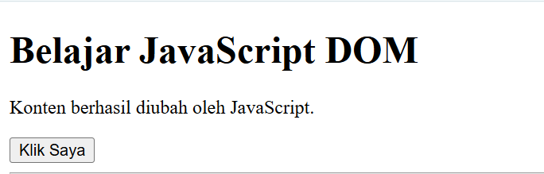

### Latihan 2 - Event Click Menampilkan Waktu
Ketika tombol "Klik Saya" ditekan, halaman menampilkan waktu saat tombol diklik.

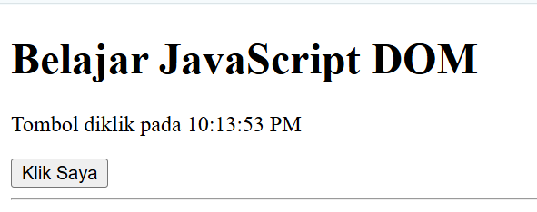

### Latihan 3 - Mengubah Gaya Teks
Sebelum tombol ditekan (tampilan awal):

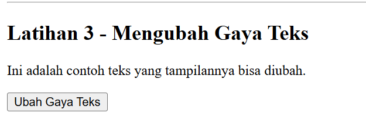

Sesudah tombol "Ubah Gaya Teks" ditekan (class CSS ditambahkan):

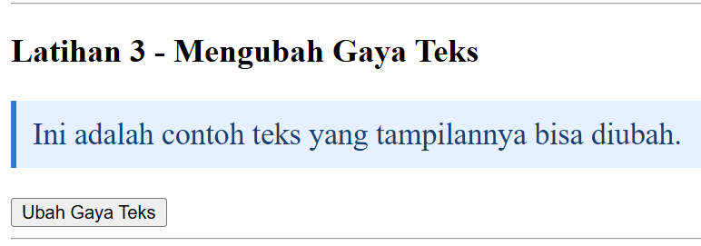

### Latihan 4 - Penghitung Karakter
Jumlah karakter pada kolom nama diperbarui secara langsung saat pengguna mengetik.

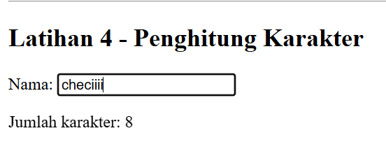

### Latihan 5 - Form Pendaftaran dengan Validasi
Usia tidak valid (di bawah 17):

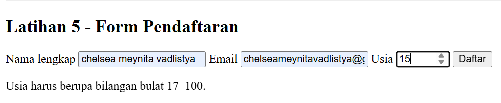

Data valid, form siap diproses:

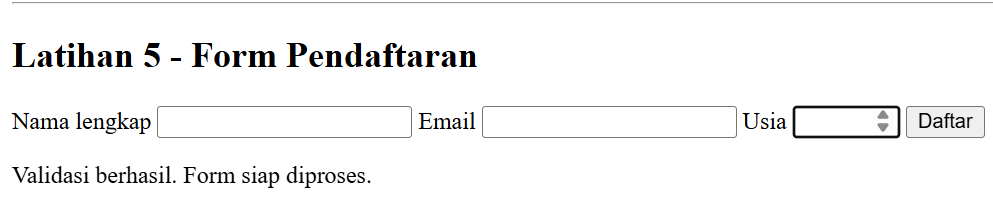

Email kosong / tidak valid:

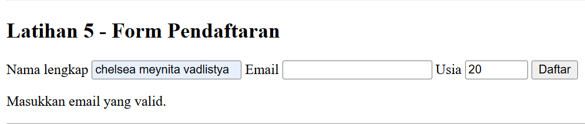

### Latihan 6 - Daftar Tugas (To-do List)
Tugas berhasil ditambahkan, dengan tombol "Tandai selesai" dan "Hapus":

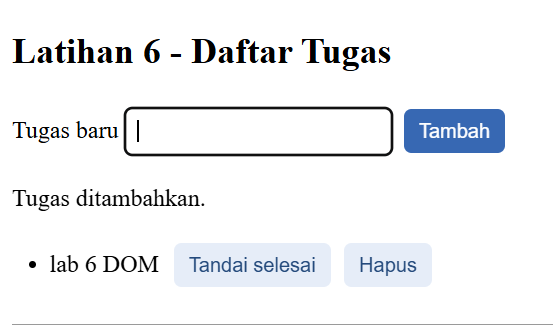

Tugas ditandai selesai (teks dicoret dan tombol berubah menjadi "Batalkan selesai"):

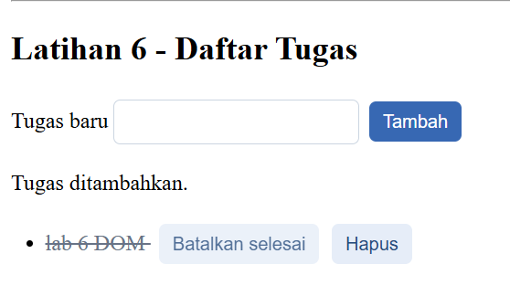

### Mini Project - Form Pendaftaran Workshop
Pengisian email tidak valid menampilkan pesan kesalahan:

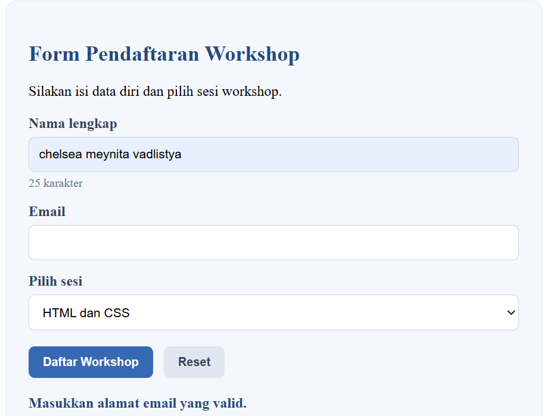

Pengisian valid menampilkan pesan berhasil beserta ringkasan data:

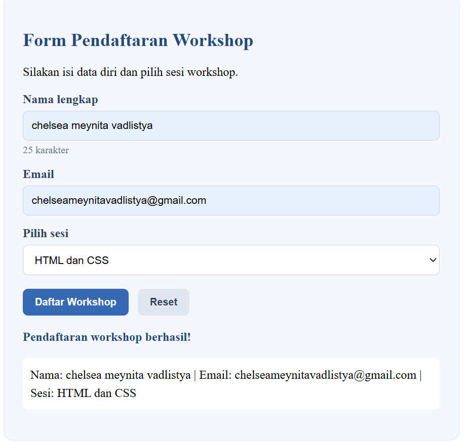

### Eksperimen Mandiri 4 - Hide/Show Paragraf
Paragraf disembunyikan (tombol berubah menjadi "Tampilkan Paragraf"):

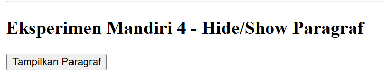

Paragraf ditampilkan kembali:

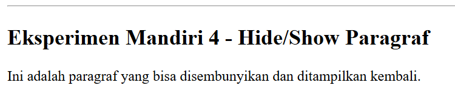

## Laporan Praktikum dan Pengumpulan

| No | Ketentuan | Status |
|----|-----------|--------|
| 1 | Membuat repository baru bernama `Lab6Web` | Sudah |
| 2 | Mengerjakan seluruh latihan dan mini project | Sudah (Latihan 1-6, mini project, eksperimen mandiri) |
| 3 | Screenshot setiap latihan, termasuk kondisi valid dan tidak valid pada form | Sudah (folder `screenshots/`) |
| 4 | README.md berisi tujuan, struktur file, cara menjalankan, langkah kerja, dan screenshot hasil | Sudah (file ini) |
| 5 | Commit file ke repository masing-masing | Sudah |
| 6 | Mengirim URL repository melalui e-learning/ecampus | Sudah sesuai arahan dosen |

## Pertanyaan Evaluasi

**1. Apa yang dimaksud dengan DOM dan apa manfaatnya?**

DOM (Document Object Model) adalah representasi dokumen HTML dalam bentuk struktur pohon berisi objek (node), yang dibuat browser saat halaman dimuat. Setiap elemen, atribut, dan teks menjadi node yang bisa diakses lewat JavaScript. Manfaatnya, JavaScript dapat membaca, mengubah, menambah, dan menghapus elemen, teks, maupun gaya tanpa memuat ulang halaman, sehingga halaman menjadi interaktif.

**2. Apa perbedaan `getElementById()`, `querySelector()`, dan `querySelectorAll()`?**

| Method | Selector | Hasil |
|--------|----------|-------|
| `getElementById("id")` | Hanya berdasarkan id (tanpa `#`) | Satu elemen, atau `null` jika tidak ada |
| `querySelector("selector")` | Selector CSS apa pun (`#id`, `.kelas`, `tag`) | Elemen **pertama** yang cocok, atau `null` |
| `querySelectorAll("selector")` | Selector CSS apa pun | `NodeList` berisi **semua** elemen yang cocok (bisa kosong) |

Contoh:
```js
document.getElementById("nama");
document.querySelector(".tombol");
document.querySelectorAll("li");
```

**3. Apa fungsi `addEventListener()` dan sebutkan tiga contoh event.**

`addEventListener()` memasang fungsi (handler) pada elemen agar dijalankan ketika event tertentu terjadi. Dengan cara ini JavaScript terpisah dari HTML dan satu elemen bisa punya beberapa listener. Contoh event:
- `click`: saat elemen diklik (tombol "Klik Saya").
- `input`: saat isi kolom berubah ketika diketik (penghitung karakter).
- `submit`: saat form dikirim (validasi form pendaftaran).

Contoh lain: `change`, `keydown`, `mouseover`.

```js
tombol.addEventListener("click", function () {
  console.log("Tombol diklik");
});
```

**4. Mengapa `event.preventDefault()` digunakan pada event submit form?**

Perilaku default submit form adalah mengirim data ke server dan memuat ulang halaman. `preventDefault()` menghentikan perilaku itu agar JavaScript bisa memvalidasi data lebih dulu, menampilkan pesan kesalahan atau pesan berhasil, tanpa halaman refresh. Data hanya diproses jika lolos validasi.

**5. Apa perbedaan `textContent` dan `innerHTML` dari sisi penggunaan dan keamanan?**

| Aspek | `textContent` | `innerHTML` |
|-------|---------------|-------------|
| Penggunaan | Membaca/mengubah teks biasa | Membaca/mengubah isi sebagai kode HTML |
| Tag HTML | Dianggap teks, tidak diproses | Diproses menjadi elemen |
| Keamanan | Aman, karena input pengguna tidak dijalankan sebagai HTML | Berisiko XSS jika memasukkan input pengguna yang tidak disaring |

Karena itu `textContent` lebih aman untuk menampilkan data dari pengguna (misalnya nama atau tugas), sedangkan `innerHTML` dipakai hanya jika memang perlu menyisipkan markup HTML dari sumber tepercaya.

**6. Bagaimana `classList.toggle()` membantu mengubah tampilan elemen?**

`classList.toggle("namaClass")` menambahkan class jika elemen belum memilikinya, dan menghapusnya jika sudah ada. Tampilan diatur lewat CSS pada class tersebut, sehingga JavaScript cukup menyalakan/mematikan class. Contohnya pada tombol "Ubah Gaya Teks" (teks berubah gaya lalu kembali normal), tugas yang dicoret saat selesai, dan tombol hide/show paragraf (class `hidden` dengan `display: none`).

```js
teks.classList.toggle("highlight");
```

**7. Sebutkan minimal tiga skenario pengujian validasi form.**

| No | Skenario | Input | Hasil yang diharapkan |
|----|----------|-------|-----------------------|
| 1 | Semua data valid | Nama "chelsea meynita vadlistya", email valid, usia 20 | Muncul pesan "Validasi berhasil. Form siap diproses." |
| 2 | Email kosong atau format salah | Email dikosongkan | Muncul pesan "Masukkan alamat email yang valid." |
| 3 | Usia di luar rentang | Usia 15 | Muncul pesan "Usia harus berupa bilangan bulat 17–100." |
| 4 | Nama terlalu pendek | Nama kurang dari 3 karakter | Muncul pesan kesalahan nama minimal tiga karakter |
| 5 | Semua kolom kosong | Tidak mengisi apa pun | Muncul pesan kesalahan, form tidak diproses |

## Kesimpulan

Melalui praktikum ini, JavaScript DOM terbukti dapat dipakai untuk mengubah konten, gaya, dan struktur halaman secara dinamis. Event `click`, `input`, `submit`, dan `change` membuat halaman responsif terhadap aksi pengguna, sedangkan validasi form membantu memastikan data yang dimasukkan sesuai aturan. Atribut `defer` memastikan script berjalan setelah elemen HTML selesai dimuat.
